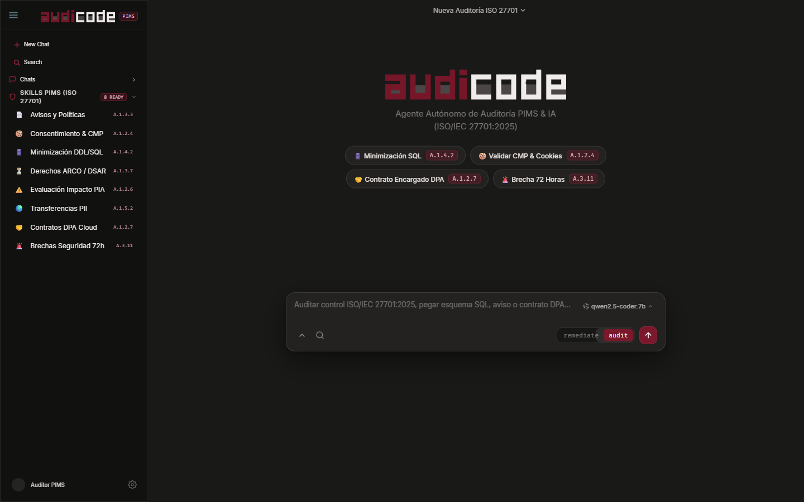

<p align="center">
  <a href="https://github.com/MarcoXMarquez/audicode">
    <picture>
      <source srcset="assets/audicodelogo.png" media="(prefers-color-scheme: dark)">
      <source srcset="assets/audicodelogo.png" media="(prefers-color-scheme: light)">
      
    </picture>
  </a>
</p>
<p align="center">The open source AI PIMS &amp; Privacy Audit Agent (ISO/IEC 27701:2025).</p>
<p align="center">
  <a href="https://github.com/MarcoXMarquez/audicode"></a>
  <a href="https://www.python.org/"></a>
  <a href="https://ollama.com/"></a>
  <a href="LICENSE"></a>
</p>

<p align="center">
  <a href="README.md">English</a> |
  <a href="README.es.md">Español</a>
</p>

[](https://github.com/MarcoXMarquez/audicode)

---

### Installation

```bash
# Quickstart (Clone & Launch Desktop App)
git clone https://github.com/MarcoXMarquez/audicode.git
cd audicode
python -m venv venv
venv\Scripts\activate             # Windows (or source venv/bin/activate on macOS/Linux)
pip install -r requirements.txt
python audicode_desktop.py
```

```bash
# Package managers & CLI runners
pipx install git+https://github.com/MarcoXMarquez/audicode.git
uv tool install git+https://github.com/MarcoXMarquez/audicode.git
```

> [!IMPORTANT]
> AudiCode needs a language model to work. Either run [Ollama](https://ollama.com) locally (`ollama pull qwen2.5-coder:7b`) **or** add a cloud provider API key from the app UI (see [Getting started](#getting-started--requirements)).

### Getting started / Requirements

- **Python 3.12+** (when running from source) and `pip`.
- **Windows 10/11** for the standalone `.exe` (Edge WebView2 runtime). macOS/Linux: run from source.
- **A model backend (one of the two):**
  1. **Local, private:** install [Ollama](https://ollama.com), then `ollama pull qwen2.5-coder:7b` and keep it running (default `http://localhost:11434`).
  2. **Cloud:** open the model/provider settings in the app and paste your API key (Gemini, OpenAI, Anthropic, ...). Keys are encrypted (Fernet) and stored in `data/api_keys.json`, with the encryption key in `data/.key`; keep `data/` out of version control. Provider keys are configured **in the UI**: `GEMINI_API_KEY` and `ANTHROPIC_API_KEY` are **not** read from the environment. Only `OPENAI_API_KEY` is read from `.env`/environment (used for OpenAI-compatible model discovery).
- Optional: copy `.env.example` to `.env` to tweak settings.

### Desktop App (BETA)

AudiCode is designed first and foremost as a native **Desktop Application** powered by `pywebview` (Edge WebView2 / WebKit) with zero browser chrome, single-click ISO/IEC 27701:2025 audit skills, and local-first privacy.

| Platform              | Download / Launcher                  |
| --------------------- | ------------------------------------ |
| Windows (x64)         | [`AudiCode-v0.1.0-windows-x64.zip`](https://github.com/MarcoXMarquez/audicode/releases/download/v0.1.0-beta/AudiCode-v0.1.0-windows-x64.zip) (Standalone `AudiCode.exe`) |
| macOS (Apple Silicon / Intel) | Coming soon (run from source meanwhile) |
| Linux                 | Coming soon (run from source meanwhile) |

```bash
# Launch native desktop window directly from source
python audicode_desktop.py

# Or on Windows via the zero-console launcher
AudiCode_Desktop.bat
```

#### Installation Directory & Environment Configuration

AudiCode respects the following priority order for configuration and skill discovery:

1. `$AUDICODE_SKILLS_DIR` - Custom directory for ISO/IEC 27701:2025 deterministic skill modules
2. `./skills` - Built-in repository skills directory
3. `./data/skills` - User-installed runtime skills and custom PIMS controls
4. `.env` - Local environment configuration (`AUTH_ENABLED=false` by default for Desktop mode)

```bash
# Examples
cp .env.example .env
python audicode_desktop.py
```

### Deployment

AudiCode can also run as a web service with Docker (`Dockerfile` / `docker-compose.yml`):

```bash
cp .env.example .env
docker compose up -d --build          # serves on http://localhost:7000
docker compose --profile ollama up -d # also starts a bundled Ollama container
```

- Port and bind address: `APP_PORT` (default `7000`) and `APP_BIND`. Persistent data lives in the `./data` volume.
- **Set `AUTH_ENABLED=true` before exposing it beyond localhost** and create credentials. Never publish the app without authentication: it can read files and run tools.
- Put it behind a reverse proxy with **HTTPS** (Caddy, nginx, Traefik) and set `SECURE_COOKIES=true`.
- Back up `./data` (including `.key`) and keep it out of version control.

### Agents

AudiCode includes two built-in specialized privacy agents you can switch between with the `Tab` key directly from the composer bar:

- **audit** - Read-only compliance inspection agent for ISO/IEC 27701:2025 assessments
  - Evaluates SQL DDL schemas, privacy notices, cookie banners (CMP), DPAs, and TIA records without mutating files
  - Produces structured Non-Conformity matrices (`PASS` / `FAIL`), legal basis verifications, and regulatory evidence logs
  - Ideal for formal PIMS audits and conformity gap analysis
- **remediate** - Full-access engineering & remediation agent
  - Generates anonymized/pseudonymized SQL DDL migrations (ISO/IEC 20889), rewrites non-compliant DPA clauses, and executes deterministic verification scripts
  - Automates technical privacy-by-design fixes across databases, APIs, and governance documents

Also included is a **general** subagent (`@general`) for multi-step cross-standard regulatory lookups (GDPR, LFPDPPP, LPDP, LGPD, EU AI Act) and complex evidence correlation.

### Deterministic Skills (ISO/IEC 27701:2025)

AudiCode ships with **8 built-in PIMS audit skills** accessible via one-click action pills in the Desktop UI (no manual Python script invocation required by the auditor):

| Skill Module                  | ISO/IEC 27701:2025 Control          | Scope & Inspection Target                                                    |
| ----------------------------- | ----------------------------------- | ---------------------------------------------------------------------------- |
| **privacy-policy-reviewer**   | Clause 5.2, A.1.3.3, A.1.3.4, A.3.3 | Audits privacy notices, layered disclosures, legal bases, and PIMS policies  |
| **consent-validator**         | A.1.2.4, A.1.2.5, A.1.3.5, A.2.2.4  | Validates CMP cookie banners, pre-ticked boxes, consent ledgers & opt-out    |
| **data-minimization-checker** | A.1.4.2, A.1.4.5–A.1.4.9, A.3.20    | Inspects SQL DDL schemas, JSON payloads, biometric over-collection & purging |
| **pii-rights-manager**        | A.1.3.6–A.1.3.10, A.2.3.2           | Audits ARCO/DSAR response SLAs, hard-delete propagation & processor notices  |
| **pia-reviewer**              | Clause 6.1.2, 8.2, A.1.2.6, A.2.2.2 | Evaluates Privacy Impact Assessments (PIA/DPIA) for AI & high-risk systems   |
| **pii-transfer-auditor**      | A.1.5.2, A.1.5.3, A.1.5.4, A.2.5.2  | Audits cross-border PII transfers, SCCs, BCRs, and Transfer Impact (TIA)     |
| **processor-contract-validator** | A.1.2.7, A.1.2.8, A.2.2.2–A.2.2.7 | Validates B2B Cloud/SaaS DPAs against mandatory Table A.2 clauses            |
| **incident-response-planner** | A.3.11, A.3.12, B.3.12              | Generates 72-hour supervisory authority breach notifications & forensic logs |

### Documentation

- **Model Agnostic Architecture**: Connect seamlessly to local models via **Ollama** (`qwen2.5-coder:7b`, `llama3.1`, `deepseek-r1`) for 100% air-gapped confidential audits, or switch on the fly to cloud providers (**Google Gemini**, **OpenAI**, **Anthropic Claude**).
- **Zero-Friction Auditor UX**: Designed specifically for privacy auditors, DPOs, and security engineers—select any ISO/IEC 27701:2025 control from the sidebar or welcome pills to inject structured audit frameworks immediately.

### Troubleshooting

| Problem | Fix |
| ------- | --- |
| "No model available" / empty model list | Start Ollama (`ollama serve`) and run `ollama pull qwen2.5-coder:7b`, or add a cloud API key in the UI. |
| A Gemini/Anthropic key in `.env` is ignored | Only `OPENAI_API_KEY` is read from the environment; enter other provider keys in the app UI. |
| Desktop window is blank on Windows | Install the Edge WebView2 runtime; as a fallback run `python app.py` and open `http://localhost:7000`. |
| Port 7000 already in use | Set `APP_PORT` to another port in `.env`. |
| Stored keys unreadable after moving `data/` | Copy `data/.key` together with `data/api_keys.json`, or re-enter the keys. |

### Contributing

See also [CONTRIBUTING.md](CONTRIBUTING.md), [SECURITY.md](SECURITY.md) and [CHANGELOG.md](CHANGELOG.md).

 If you're interested in contributing to AudiCode, please follow these guidelines before submitting a pull request:

1. Fork the repository and create your feature branch (`git checkout -b feat/new-iso-control`).
2. Ensure any new privacy skill under `skills/<skill-name>/` includes a valid `SKILL.md` specification and deterministic verification rules mapped to **ISO/IEC 27701:2025**.
3. Verify the Desktop UI launches cleanly via `python audicode_desktop.py`.

### Building on AudiCode

If you are working on a project that is related to AudiCode and is using "audicode" as part of its name (for example, "audicode-dashboard" or "audicode-ci"), please add a note to your README to clarify that it is not built by the AudiCode team and is not affiliated with us in any way.

---

### FAQ

#### How is this different from generic chat interfaces?

- **100% Purpose-Built for ISO/IEC 27701:2025**: Every sidebar action, quick-pill, and agent prompt is mapped directly to Annex A & Annex B controls of the 2025 PIMS standard.
- **Native Desktop Experience**: Runs in a dedicated desktop window with a minimalist dark graphite & crimson aesthetic inspired by Claude Desktop and ChatGPT Codex Desktop.
- **Hybrid Local + Cloud Inference**: Keep sensitive PII schemas, contracts, and breach records strictly on-device with Ollama, or leverage frontier cloud models when needed.

---

### License, attribution & disclaimer

AudiCode is a fork of the open source Odysseus project and is distributed under the **GNU AGPL-3.0** (see [LICENSE](LICENSE)). If you run a modified version as a network service you must offer its source to its users. Credit and thanks to the original Odysseus authors.

AudiCode is an assistive tool, not legal advice, and does not by itself certify ISO/IEC 27701 conformity. Have its output reviewed by a qualified professional.
