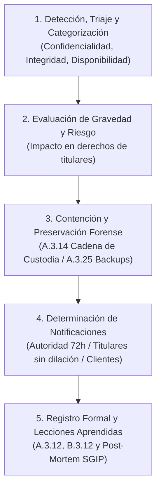

# Incident Response Planner (ISO/IEC 27701:2025)

## 1. Propósito y Alcance Normativo

La skill `incident-response-planner` está especializada en auditar, formular y ejecutar planes de respuesta a incidentes de seguridad de la información que involucren o puedan comprometer datos personales (*PII Breaches*), asegurando la conformidad estricta con el estándar internacional **ISO/IEC 27701:2025** (*Privacy Information Management System - PIMS*), en articulación con las directrices técnicas de **ISO/IEC 27035** (todas sus partes) e **ISO/IEC 27002:2022**.

### 1.1 Controles Nucleares Auditados
- **Control A.3.11 (Guía B.3.11)**: *Information security incident management planning and preparation*. Plan maestro de incidentes con PII, funciones y responsabilidades del CSIRT/CIRT de privacidad, procedimientos de escalamiento, simulacros periódicos y protocolos de notificación legal.
- **Control A.3.12 (Guía B.3.12)**: *Response to information security incidents*. Ejecución operativa de la contención, mitigación, erradicación, recuperación, libro de registro obligatorio de brechas (*Incident Record*) y lecciones aprendidas post-incidente.
- **Guía B.3.12 (Párrafo Procesadores) y Control A.2.2.2 / Guía B.2.2.2**: Obligación del encargado de notificar sin dilación indebida al responsable y aportar asistencia técnica y evidencia completa.
- **Control A.3.14 (Guía B.3.14)**: *Protection of records*. Preservación de la integridad, autenticidad y cadena de custodia de registros de auditoría, logs de eventos y evidencias forenses.
- **Control A.3.25 (Guía B.3.24)**: *Information backup*. Resiliencia y capacidad de restauración íntegra y segura de datos personales ante incidentes de disponibilidad, alteración o ataques de ransomware.

### 1.2 Distinción Conceptual Crítica
1. **Evento de Seguridad (*Security Event*)**: Suceso identificado en un sistema, servicio o red que indica una posible brecha de seguridad o falla de controles (ej. escaneo de puertos, intentos fallidos de autenticación, pings inusuales) sin afectación comprobada de PII.
2. **Incidente de Seguridad de la Información (*Security Incident*)**: Evento o serie de eventos de seguridad no deseados o inesperados que tienen una probabilidad significativa de comprometer las operaciones de negocio y amenazar la seguridad de la información.
3. **Brecha de Datos Personales (*PII Breach*)**: Todo incidente de seguridad que cause la destrucción, pérdida, alteración accidental o ilícita, o la comunicación o acceso no autorizados a datos personales transmitidos, almacenados o tratados de cualquier forma (compromiso de Confidencialidad, Integridad o Disponibilidad de PII).

---

## 2. Disparadores de Activación (User Triggers)

Esta skill debe activarse de forma prioritaria cuando se presenten solicitudes como:
- *"Hemos detectado una posible filtración de bases de datos de clientes; ¿cómo determinamos si debemos notificar en 72 horas?"*
- *"Sufrimos un ataque de ransomware que cifró servidores con datos personales; ¿cómo procedemos bajo el control A.3.11 y A.3.25?"*
- *"Audita nuestro Plan Maestro de Respuesta a Brechas de Privacidad bajo ISO/IEC 27701:2025 y B.3.11."*
- *"Check our data breach register and incident log template against ISO 27701 control A.3.12 and B.3.12."*
- *"¿Qué información mínima debe comunicarse a los titulares afectados cuando existe un riesgo alto para sus derechos?"*
- *"Un proveedor SaaS nos informó de una brecha en sus sistemas donde alojamos datos de nómina; ¿cuáles son los pasos de respuesta?"*
- *"¿Cómo estructuramos la preservación de evidencia forense y logs según A.3.14 sin destruir pistas durante la contención?"*

---

## 3. Demarcación de Fronteras y Reglas de Qué NO Hacer

Para salvaguardar la exactitud técnica, la objetividad probatoria y la coherencia del SGIP, el auditor debe acatar rigurosamente:

### Qué NO Hacer
1. **NO emitir asesoría jurídica definitiva ni dictámenes legales vinculantes**: Toda recomendación constituye una orientación técnica de auditoría y gestión de conformidad bajo ISO/IEC 27701:2025. Debe recomendarse siempre la intervención del DPO y asesoría legal corporativa.
2. **NO ocultar, minimizar ni demorar el registro de brechas de PII**: Está estrictamente prohibido intentar "resolver internamente" una brecha sin dejar constancia formal en el expediente de incidentes. Toda brecha confirmada debe asentarse en el registro formal (A.3.12).
3. **NO exceder los plazos legales perentorios de notificación**: No diferir la notificación formal a la Autoridad de Control más allá de las 72 horas (o el límite legal aplicable) justificando una "investigación inconclusa". Si la investigación continúa, se emite una notificación inicial preliminar por fases.
4. **NO destruir logs ni sobreescribir evidencia forense durante la contención o restauración**: Nunca reiniciar, formatear o restaurar servidores comprometidos sin antes capturar volcados de memoria volátil, imágenes forenses de disco y copias protegidas de logs (A.3.14).
5. **NO asumir ni conjeturar datos faltantes**: Si se desconoce el número de afectados, las categorías de datos o la causa raíz, documentar explícitamente el estado como "bajo investigación preliminar" y requerir datos concretos al usuario sin suposiciones infundadas.
6. **Límites con otras skills del ecosistema**:
   - **NO auditar avisos de privacidad generales en frío**: La redacción del aviso público corresponde a `privacy-policy-reviewer`.
   - **NO auditar contratos mercantiles o DPAs estándar en frío**: La revisión de cláusulas generales B2B corresponde a `processor-contract-validator`.
   - **NO gestionar solicitudes individuales de derechos ARCO/DSAR**: Si un titular afectado por la brecha ejerce su derecho de supresión o acceso, derivar a `pii-rights-manager`.
   - **NO reconfigurar esquemas SQL ni parámetros de base de datos**: La auditoría a nivel de campos y minimización corresponde a `data-minimization-checker`.

---

## 4. Flujo de Trabajo Operativo Paso a Paso



### Paso 1: Detección, Triaje y Categorización del Incidente
1. **Verificar el hecho**: Confirmar si el evento constituye una brecha de datos personales según la definición de ISO/IEC 27701:2025.
2. **Clasificar el impacto sobre la PII**:
   - **Brecha de Confidencialidad**: Divulgación no autorizada o acceso ilegítimo a PII (ej. exfiltración, credenciales expuestas, envío erróneo de base de datos por correo).
   - **Brecha de Integridad**: Alteración no autorizada o accidental de PII (ej. inyección SQL no autorizada, corrupción de expedientes médicos, manipulación de cuentas bancarias).
   - **Brecha de Disponibilidad**: Pérdida de acceso o destrucción de PII (ej. ataque de ransomware, pérdida física de soportes de respaldo, denegación de servicio que impida el acceso a datos críticos de salud o transacciones).
3. **Identificar el rol de la organización**: Determinar si actúa como Responsable (*PII Controller*) o como Encargado (*PII Processor*).

### Paso 2: Evaluación de Gravedad y Riesgo para los Titulares
1. Evaluar objetivamente el riesgo para los derechos y libertades de las personas afectadas siguiendo los criterios detallados en [breach_notification_rules.md](references/breach_notification_rules.md):
   - **Naturaleza y sensibilidad de la PII**: Datos identificativos básicos vs categorías especiales (salud, biometría, ideología), credenciales de autenticación, datos financieros o datos de menores.
   - **Volumen y alcance**: Número de titulares afectados y cantidad de registros comprometidos.
   - **Facilidad de identificación**: Datos en texto claro vs seudonimizados vs cifrados con algoritmo robusto cuyas claves no fueron comprometidas.
   - **Consecuencias probables**: Perjuicios económicos, suplantación de identidad, discriminación, extorsión, acoso o daño reputacional.
2. Determinar la escala de severidad: **Bajo**, **Medio**, **Alto** o **Extremo**.

### Paso 3: Contención Inmediata, Resiliencia y Preservación Forense (A.3.14 y A.3.25)
1. **Medidas de contención técnica inmediata**: Aislar segmentos de red, revocar tokens y sesiones comprometidas, bloquear credenciales de acceso vulneradas y cerrar puertos o servicios atacados sin apagar la máquina (para preservar memoria RAM).
2. **Preservación de evidencia forense (Control A.3.14)**:
   - Adquirir copias bit a bit de discos y volcados de memoria volátil.
   - Proteger la inmutabilidad de los registros de auditoría y logs de firewall, proxy, autenticación y acceso.
   - Registrar la cadena de custodia: fecha, hora, hash criptográfico (SHA-256) de la evidencia y custodio responsable.
3. **Resiliencia y restauración segura (Control A.3.25)**:
   - Verificar la integridad y aislamiento (*air-gap* / inmutabilidad) de los respaldos antes de restaurar.
   - Sanear los vectores de entrada antes de reintegrar bases de datos a producción.

### Paso 4: Determinación y Ejecución de Notificaciones Obligatorias
Consultar la guía de plazos y plantillas formales en [breach_notification_rules.md](references/breach_notification_rules.md):
1. **Notificación a la Autoridad de Control (A.3.11 / B.3.11)**:
   - Si existe riesgo para los derechos de los titulares: notificar dentro del **plazo máximo legal de 72 horas** desde que se tuvo constancia.
   - Si no se cuenta con todos los detalles técnicos en 72 horas, realizar una **notificación inicial por fases** con la información disponible, indicando fecha para el reporte complementario.
2. **Notificación a los Titulares de PII (A.3.11 / B.3.11)**:
   - Si el riesgo evaluado en el Paso 2 es **Alto o Extremo**, comunicar directamente a los afectados **sin dilación indebida**, en lenguaje claro y transparente, proporcionando recomendaciones de autoprotección.
3. **Notificación del Encargado al Responsable (B.3.12 y B.2.2.2)**:
   - Si la organización actúa como procesador, notificar formalmente al cliente de manera **inmediata** (plazo contractual típico de 24 a 48 horas), facilitando la descripción del incidente, volumen preliminar y puntos de contacto.

### Paso 5: Registro Formal Detallado y Lecciones Aprendidas (A.3.12 y B.3.12)
1. **Generación determinista del expediente oficial**:
   Ejecutar el script automatizado para crear el registro inmutable en JSON y Markdown:
   ```bash
   python skills/incident-response-planner/scripts/incident_record_generator.py --sample --output-json formal_incident_record.json --output-md formal_incident_record.md
   ```
2. **Verificación de campos mandatorios bajo ISO 27701 B.3.12**:
   - Fecha/hora de detección, confirmación, contención y cierre.
   - Identificación del informante y del equipo que recibió el reporte.
   - Causa raíz y vulnerabilidades explotadas.
   - Consecuencias e impactos reales o potenciales.
   - Medidas de mitigación tomadas (con responsable asignado y datos recuperados de backup A.3.25).
   - Constancia explícita de afectación a Confidencialidad, Integridad y/o Disponibilidad.
   - Categorías y volumen aproximado de PII comprometida.
   - Detalle de notificaciones efectuadas (destinatarios, fechas, acuses de recibo).
3. **Post-Mortem y Mejora Continua**:
   - Realizar la sesión de lecciones aprendidas con CSIRT, TI, Legal y DPO.
   - Actualizar la evaluación de riesgos del PIMS (Cláusulas 6.1.2 y 8.2), políticas y controles preventivos.

---

## 5. Matriz de Severidad de Deficiencias y Plan de Acción de Contingencia

### 5.1 Matriz de Severidad de Deficiencias en Auditoría

| Severidad | Criterio de Calificación | Impacto en el SGIP | Plazo de Subsanación |
|---|---|---|---|
| **Crítica** | Brecha activa no documentada u ocultada; superación del plazo de 72 horas sin notificación a la autoridad; borrado deliberado o pérdida de logs forenses; inexistencia total de plan de respuesta a brechas. | Compromete la certificación PIMS, genera responsabilidad penal/administrativa directa y multas graves. | Inmediato (< 24 horas) |
| **Mayor** | Ausencia de criterios objetivos para evaluar el riesgo a titulares; plan de incidentes puramente técnico que no incluye al DPO ni a la asesoría legal; backups de PII no probados ni aislados; contratos con encargados sin ventana de notificación. | No conformidad mayor en auditoría externa; alto riesgo de demoras críticas durante una crisis real. | Corto plazo (< 7 días) |
| **Menor** | Plantillas de notificación desactualizadas; retraso leve en la actualización de la cadena de llamada del CSIRT; libro de registro sin desglose específico de datos recuperados. | Observación auditable; debe corregirse en el ciclo regular de mejora. | Medio plazo (< 30 días) |
| **Oportunidad de Mejora (OM)** | Automatizar la integración entre SIEM y el libro de registro de brechas; incrementar la frecuencia de simulacros (*tabletop exercises*) a semestrales. | Optimiza los tiempos de respuesta y madurez del SGIP. | Próxima revisión del SGIP |

### 5.2 Plan de Acción de Contingencia ante Crisis Activa

```
[Minuto 0 - 60]: Aislamiento técnico + Activación de CSIRT de Privacidad + Congelamiento de logs (A.3.14)
[Hora 1 - 12]: Triaje de PII + Evaluación preliminar de riesgo a titulares + Identificación de copias de seguridad (A.3.25)
[Hora 12 - 48]: Erradicación de la amenaza + Convocatoria de Comité de Crisis (DPO/Legal/C-Level) + Redacción de notificación
[Hora 48 - 72]: Envío de notificación formal a la Autoridad de Control + Envío de avisos directos a titulares (si riesgo alto)
[Semana 1 - 2]: Informe pericial complementario + Generación del Registro Formal B.3.12 + Cierre de lecciones aprendidas
```

---

## 6. Formato Estándar de la Tabla de Hallazgos

Todo dictamen de auditoría emitido por esta skill debe presentar los hallazgos en la siguiente estructura tabular unificada:

| ID | Control ISO/IEC 27701:2025 | Elemento Evaluado | Severidad | Hallazgo / Evidencia Faltante | Recomendación de Subsanación / Acción Concreta |
|---|---|---|---|---|---|
| **H-IR-01** | Control A.3.11 / B.3.11 | Plazo y Flujo de Notificación | Crítica | El plan de respuesta no contempla el plazo de 72 horas ni define el procedimiento de reporte ante la Autoridad de Protección de Datos. | Incorporar el protocolo formal de notificación a la autoridad dentro del límite de 72 horas con plantillas preaprobadas por el DPO. |
| **H-IR-02** | Control A.3.14 | Protección de Evidencias Forenses | Crítica | Durante la restauración tras un incidente, se sobreescribieron los registros de eventos de autenticación del servidor comprometido. | Establecer como procedimiento obligatorio el volcado forense y la preservación inmutable de logs antes de cualquier reinicio o restauración. |
| **H-IR-03** | Control A.3.12 / B.3.12 | Libro de Registro de Incidentes | Mayor | El registro de incidentes omite el desglose específico de las categorías de PII expuestas y los datos recuperados de respaldo. | Implementar el modelo de registro formal según B.3.12 utilizando el script determinista `incident_record_generator.py`. |
| **H-IR-04** | Control A.3.25 | Verificación de Respaldo ante Ransomware | Mayor | No existen pruebas periódicas de restauración de datos personales desde copias de seguridad aisladas (*air-gapped*). | Ejecutar simulacros semestrales de restauración de PII y documentar el tiempo objetivo de recuperación (RTO/RPO). |
| **H-IR-05** | Control A.3.11 | Pruebas y Simulacros | Menor | El último simulacro de brecha de privacidad se realizó hace más de 18 meses y no involucró al equipo legal ni al portavoz corporativo. | Programar ejercicios de mesa (*tabletop*) anuales con participación obligatoria de Seguridad, TI, Legal, DPO y Comunicaciones. |

---

## 7. Referencias y Recursos de Apoyo

Para consultar criterios ampliados, matrices de riesgo, normativas por país, plantillas y herramientas deterministas:
- **Criterios de evaluación de riesgo, plazos legales y plantillas de notificación**: [breach_notification_rules.md](references/breach_notification_rules.md)
- **Generador determinista del registro formal de incidentes**: [incident_record_generator.py](scripts/incident_record_generator.py)
