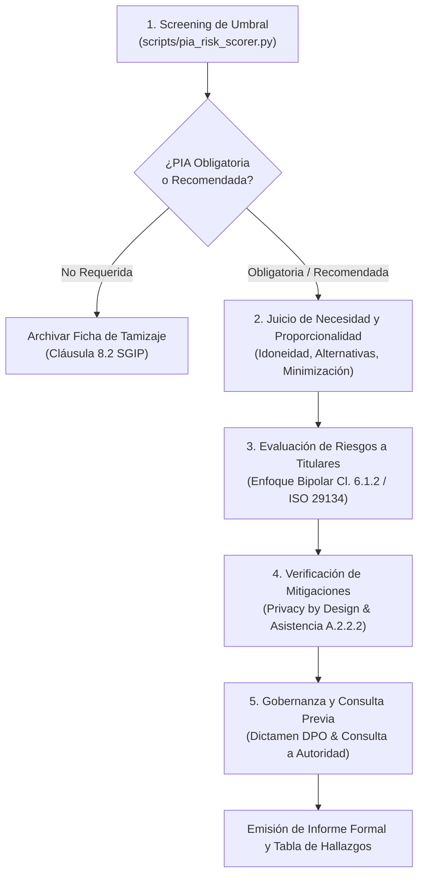

# PIA Reviewer - Evaluación de Impacto en la Privacidad (ISO/IEC 27701:2025)

## 1. Propósito y Alcance

Esta skill audita, estructura y evalúa formalmente las **Evaluaciones de Impacto en la Privacidad (*Privacy Impact Assessments* - PIA / EIPD)** conforme al estándar internacional **ISO/IEC 27701:2025**, articulando:
1. **Control A.1.2.6 (Guía B.1.2.6)**: Tamizaje de necesidad, umbrales obligatorios, análisis de impacto y plan de mitigación en el diseño del sistema.
2. **Cláusula 6.1.2 y Cláusula 8.2**: Proceso continuo y estructurado de apreciación de riesgos de privacidad del SGIP (*Privacy risk assessment*), con evaluación bipolar (impacto en titulares vs impacto en la organización).
3. **Control A.2.2.2 (Guía B.2.2.2)**: Obligación contractual del encargado de facilitar asistencia técnica, información arquitectónica y soporte en consultas previas.
4. **Estándares metodológicos vinculados**: ISO/IEC 29134:2017 (directrices para PIA) e ISO/IEC 27557:2022 (gestión de riesgos de privacidad organizacional).

---

## 2. Límites y Reglas de No Solapamiento (Handoffs)

Para asegurar la coherencia del ecosistema de auditoría de privacidad, respeta las siguientes demarcaciones:

| Situación Detectada | Acción de la Skill | Handoff / Derivación |
|---|---|---|
| Evaluación de necesidad de PIA, diagrama de flujos (DFD), proporcionalidad y riesgos macro del proyecto | **Asumir como competencia principal**. | Ejecución directa en `pia-reviewer`. |
| La PIA requiere seudonimizar campos, verificar TTL en logs o purgar tablas de base de datos | Dictaminar el requerimiento en el plan de mitigación. | **Derivar a `data-minimization-checker`** para inspeccionar esquemas SQL, scripts o APIs. |
| El proyecto involucra proveedores externos y se requiere auditar el contrato DPA completo | Verificar la cláusula de asistencia en PIA (A.2.2.2). | **Derivar a `processor-contract-validator`** para auditar el contrato integral bajo Tabla A.2. |
| El proyecto transfiere datos personales a servidores o proveedores en terceros países | Evaluar el riesgo macro de transferencia en la PIA. | **Derivar a `pii-transfer-auditor`** para auditar SCCs, BCRs y la TIA específica (A.1.5.2). |
| Se detecta una brecha de seguridad materializada durante la fase operativa | Detener el screening de PIA. | **Transferir de inmediato a `incident-response-planner`** (A.3.11 / A.3.12). |

---

## 3. Flujo de Trabajo Paso a Paso



### Paso 1: Screening de Obligatoriedad y Umbral (*Threshold Assessment*)
1. Determina si el proyecto o cambio tecnológico califica dentro de los 10 criterios de alto riesgo normativos (ver catálogo completo en `references/pia_threshold_matrix.md`):
   - **Toma de decisiones automatizadas** o elaboración de perfiles con efectos jurídicos (C1/C2).
   - **Tratamiento a gran escala de datos sensibles** (salud, biometría unívoca, genética, opiniones políticas) (C3).
   - **Observación o vigilancia sistemática a gran escala** en espacios públicos o telemetría continua (C4).
   - **Datos de colectivos vulnerables** (menores de edad, empleados en relación de asimetría, pacientes) (C5).
   - **Uso de tecnologías emergentes, IA o modelos predictivos opacos** (C6).
   - **Cruce o correlación masiva de bases de datos** con finalidades incompatibles (C7).
   - **Exclusión de acceso a derechos o servicios esenciales** (C8).
   - **Tratamiento masivo (>10k titulares)** o transferencias internacionales de riesgo (C9/C10).
2. Para una calificación matemática determinista, ejecuta:
   ```bash
   python skills/pia-reviewer/scripts/pia_risk_scorer.py --project "<nombre>" [flags]
   ```
3. Si el dictamen es **OBLIGATORIA**, la organización no puede pasar el sistema a producción sin completar las fases siguientes (A.1.2.6).

### Paso 2: Análisis de Necesidad y Proporcionalidad
Verifica y documenta el triple juicio de proporcionalidad:
1. **Juicio de Idoneidad**: ¿El tratamiento es capaz de conseguir el objetivo legítimo perseguido?
2. **Juicio de Necesidad**: ¿Existe un medio alternativo menos invasivo que logre el mismo fin? (Ejemplo: verificación local en dispositivo vs base de datos biométrica centralizada).
3. **Juicio de Proporcionalidad en sentido estricto**: ¿Los beneficios del tratamiento superan el impacto en la privacidad de las personas?
4. **Legitimidad y Base Legal**: Verifica que las finalidades estén delimitadas y sustentadas en una base jurídica válida (consentimiento, contrato, interés legítimo ponderado).

### Paso 3: Evaluación de Riesgos para los Derechos y Libertades de los Titulares
Conforme a la **Cláusula 6.1.2**, evalúa las consecuencias bajo el **enfoque bipolar obligatorio**:
1. **Impacto en el Titular (*PII Principal*)**:
   - Analiza escenarios de daño tangible: discriminación algorítmica, usurpación de identidad, pérdidas financieras, daño moral, pérdida de autonomía o exclusión social.
   - Aplica la escala de impacto (1: Insignificante a 4: Catastrófico) de `references/privacy-risk-matrix-guide.md`.
2. **Impacto en la Organización**:
   - Sanciones regulatorias, litigios civiles, interrupción operativa y daño reputacional.
   - *Regla crítica*: El riesgo organizacional nunca puede justificar la aceptación unilateral de un riesgo no mitigado para el titular.
3. **Estimación de Probabilidad y Riesgo Inherente**:
   - Calcula el nivel de riesgo inherente: $Riesgo = Probabilidad \times Impacto$.

### Paso 4: Verificación de Medidas Mitigadoras y Privacy by Design
1. Audita las salvaguardas técnicas y organizativas propuestas para cada riesgo detectado:
   - Técnicas: Cifrado en reposo/tránsito, seudonimización con salteado criptográfico, control de acceso granular (RBAC), logs de auditoría inmutables, aislamiento de entornos.
   - Organizativas: Políticas de retención, capacitación de operadores, acuerdos de confidencialidad.
2. **Asistencia del Encargado (Control A.2.2.2)**:
   - Si el sistema utiliza servicios cloud o SaaS de terceros, comprueba que el encargado proporcione arquitectura técnica, reportes de seguridad y asistencia documentada para la PIA.
3. **Cálculo del Riesgo Residual**: Evalúa si tras aplicar las salvaguardas, el nivel de riesgo desciende a niveles aceptables (Bajo o Medio tolerable).

### Paso 5: Gobernanza, Dictamen del DPO y Consulta Previa
1. **Consulta al DPO / Responsable de Privacidad (B.3.4)**:
   - La PIA debe someterse formalmente a revisión del Delegado de Protección de Datos. El informe debe registrar si el dictamen es favorable, condicionado o desfavorable.
2. **Consulta a Titulares**:
   - Registrar si se consultó la opinión de los titulares o sus representantes legales cuando el tratamiento impacta colectivos específicos (ej. empleados o usuarios).
3. **Criterio de Consulta Previa a la Autoridad de Supervisión**:
   - Si tras el diseño de medidas mitigadoras persiste un **Riesgo Residual Alto o Crítico** que la organización no puede reducir razonablemente, se debe activar la **Consulta Previa Obligatoria** ante la autoridad de control de privacidad antes de iniciar el tratamiento.

---

## 4. Tabla Estándar de Hallazgos de Auditoría

Toda evaluación debe estructurar sus hallazgos en la siguiente tabla formal:

| ID | Control ISO 27701:2025 | Severidad | Hallazgo y Evidencia Identificada | Impacto en Titular / SGIP | Recomendación Concreta de Mitigación |
|:---:|:---:|:---:|---|---|---|
| **H-01** | A.1.2.6 | **Crítica** | Tratamiento biométrico desplegado sin evaluación previa de impacto ni screening documentado. | Alto riesgo de vulneración de derechos; incumplimiento flagrante de A.1.2.6 y RGPD Art. 35. | Suspender el uso en producción, ejecutar tamizaje con `pia_risk_scorer.py` y completar la PIA formal. |
| **H-02** | Cláusula 6.1.2 | **Mayor** | Matriz de riesgos evalúa exclusivamente impacto financiero para la empresa, omitiendo daños al titular. | Desalineación con el enfoque bipolar mandatorio de la norma; sesgo en la aceptación de riesgos. | Reestructurar la matriz incorporando escalas de impacto en la persona física (ver `privacy-risk-matrix-guide.md`). |
| **H-03** | A.2.2.2 | **Mayor** | Proveedor cloud no provee documentación técnica de arquitectura ni asume deber de asistencia en PIA. | Imposibilidad de validar la seguridad real del tratamiento y flujos de transferencia. | Exigir anexo contractual de asistencia según A.2.2.2 / Tabla A.2 o reconsiderar la selección del proveedor. |
| **H-04** | Cláusula 8.2 | **Menor** | No existe procedimiento programado para reevaluar la PIA ante cambios sustanciales en la IA o APIs. | Desactualización progresiva del perfil de riesgos frente a derivas del modelo algorítmico (*drift*). | Establecer hito de revisión periódica obligatoria cada 12 meses o ante cambios de arquitectura en el SGIP. |
| **H-05** | B.3.4 | **OFI** | El DPO no participó en las fases tempranas de diseño arquitectónico del proyecto (*Privacy by Design*). | Retrasos en la aprobación final del sistema y posibles costos de rediseño tardío. | Integrar la revisión del DPO como compuerta de aprobación obligatoria en el ciclo de vida del desarrollo. |

### Criterios de Severidad Normativa
- **Crítica**: Tratamiento de alto riesgo en producción sin PIA, vulneración grave inminente de derechos o ausencia de consulta regulatoria obligatoria.
- **Mayor**: Ausencia de evaluación del impacto en los titulares, falta de base jurídica, o negativa de asistencia técnica del encargado (A.2.2.2).
- **Menor**: Deficiencias metodológicas subsanables, falta de formalización en plantillas estándar, o retrasos en la firma del DPO.
- **Oportunidad de Mejora (OFI)**: Recomendaciones de optimización preventiva, mejora de diagramas DFD o automatización de screenings.

---

## 5. Qué NO Hacer (Reglas Mandatorias del Auditor)

1. **NO emitir asesoría legal definitiva ni dictámenes jurídicos vinculantes**:
   - Esta skill proporciona evaluaciones técnicas y metodológicas de auditoría bajo ISO/IEC 27701:2025 e ISO/IEC 29134. Siempre aclara que la validez legal concluyente corresponde al DPO institucional y a la asesoría jurídica calificada.
2. **NO asumir datos faltantes ni inventar arquitectura técnica**:
   - Si no se dispone del diagrama de flujo de datos, tipos de datos tratados o ubicación de servidores, solicita explícitamente la información antes de concluir la evaluación.
3. **NO sustituir el rol del Delegado de Protección de Datos (DPO)**:
   - La skill evalúa y asiste en la redacción de la PIA, pero el visto bueno preceptivo debe ser emitido por el DPO o responsable de privacidad formalmente designado.
4. **NO descender a inspección técnica de esquemas de bases de datos o código fuente**:
   - Si se requiere auditar columnas SQL, campos innecesarios en payloads JSON o algoritmos de hashing, **delega inmediatamente a `data-minimization-checker`**.
5. **NO validar despliegues con riesgo residual Alto sin alertar de Consulta Previa**:
   - Si los controles propuestos no mitigan suficientemente el riesgo para los titulares, nunca des por cerrada la PIA como "conforme"; marca el requerimiento legal de consulta ante la autoridad de supervisión.

---

## 6. Recursos y Referencias Progresivas

Para profundizar en aspectos específicos de la evaluación, consulta los siguientes recursos complementarios:
- [Catálogo de Criterios y Matriz de Umbrales](references/pia_threshold_matrix.md): Detalle operativo de los 10 criterios de riesgo alto y reglas de decisión.
- [Plantilla de Informe de PIA (ISO 29134)](references/iso-29134-report-template.md): Estructura formal completa para documentar la evaluación.
- [Guía de Matriz de Riesgos Bipolar](references/privacy-risk-matrix-guide.md): Escalas cuantitativas y cualitativas de probabilidad e impacto para titulares y SGIP.
- [Script Calificador de Riesgo](scripts/pia_risk_scorer.py): Herramienta CLI en Python para scoring determinista de proyectos.

---

## Soporte Local de Documentos, Formularios e Imágenes (AudiCode Local Engine)

AudiCode procesa todos los archivos adjuntos de forma **100% local en tu CPU** antes de pasarlos a este agente:
- **Presentaciones de Arquitectura (.pptx)**: Diapositivas de diseño de sistemas, flujos de datos y arquitectura de IA se extraen como secciones Markdown estructuradas mediante markitdown.
- **Cuestionarios y Matrices de Riesgo (.xlsx, .docx, .pdf)**: Evaluaciones de impacto y matrices de probabilidad/impacto se convierten en tablas Markdown completas (|---|) vía pymupdf4llm y markitdown.
- **Diagramas y Capturas (.png, .jpg)**: Diagramas de flujo y esquemas se analizan con OCR local para extraer nombres de componentes, bases de datos y flujos de PII.
