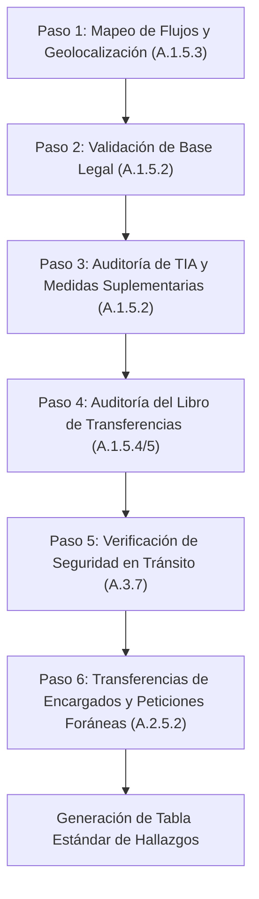

# PII Transfer Auditor

Skill especializada en auditar la legitimidad, gobernanza documental, trazabilidad geográfica y seguridad técnica de las transferencias transfronterizas e internacionales de datos personales conforme al estándar **ISO/IEC 27701:2025**.

---

## 1. Propósito y Controles Normativos de Referencia

La skill evalúa de manera sistemática la conformidad de los flujos de datos personales que cruzan fronteras jurisdiccionales, la adecuación territorial, las garantías contractuales suplementarias y la gestión de requerimientos de autoridades foráneas.

### Mapeo de Controles ISO/IEC 27701:2025
- **A.1.5.2** (*Identify basis for PII transfer between jurisdictions*): Justificación jurídica formal de transferencias (Adecuación, SCC, BCR, excepciones legítimas y TIA).
- **A.1.5.3** (*Countries and international organizations to which PII can be transferred*): Inventario territorial transparente de países y centros de datos receptores.
- **A.1.5.4** (*Records of PII transfers*): Mantenimiento inmutable del libro de registro de transferencias transfronterizas.
- **A.1.5.5** (*Records of PII disclosure*): Registro fehaciente de revelaciones ante mandatos y órdenes judiciales o gubernamentales.
- **A.2.5.2** (*Notification of PII transfer*): Notificación previa y vinculante del encargado al responsable ante cambios de jurisdicción territorial.
- **A.2.5.3** (*Transfer of PII between jurisdictions*): Ejecución de transferencias por el encargado sujeta estrictamente a autorización del responsable.
- **A.2.5.5 y A.2.5.6** (*Legally binding disclosures & non-binding requests*): Notificación de requerimientos legales foráneos y rechazo de solicitudes sin mandamiento judicial vinculante.
- **A.3.7** (*Information transfer*): Medidas de seguridad y cifrado aplicadas a canales de transmisión de datos personales.

> **Nota sobre ISO/IEC 27701:2019**: Reemplaza y actualiza las antiguas Cláusulas 7.5.1, 7.5.2, 7.5.3, 7.5.4, 8.5.1, 8.5.4 y 6.10.1.

---

## 2. Demarcación de Fronteras (Límites Estrictos)

Para evitar duplicidades o interferencias en el conjunto de skills, se aplican las siguientes reglas de demarcación estricta:

- **QUÉ AUDITA ESTA SKILL**:
  * La dimensión transfronteriza y geográfica de los flujos de PII.
  * La validez formal y sustantiva del mecanismo internacional empleado (Decisión de Adecuación, SCC Módulos 1-4, BCR, excepciones tasadas).
  * La suficiencia técnica de las Evaluaciones de Impacto de Transferencia (TIA) y medidas suplementarias frente a leyes de vigilancia del país receptor (FISA 702, Cloud Act, etc.).
  * El inventario geográfico de servidores, regiones cloud y accesos remotos de soporte 24/7.
  * El Libro de Registro de Transferencias y Divulgaciones (A.1.5.4 y A.1.5.5).
  * El protocolo de respuesta ante requerimientos de información policiales o judiciales foráneos (A.2.5.5 y A.2.5.6).

- **QUÉ SE DELEGA A OTRAS SKILLS (HANDOFFS)**:
  * **Handoff a `processor-contract-validator`**: Si al auditar una transferencia se detecta que el receptor es un encargado que carece de DPA firmado, o si se requiere auditar las cláusulas operativas generales de confidencialidad, propiedad de datos o deber de asistencia (Tabla A.2), se deriva a `processor-contract-validator`.
  * **Handoff a `privacy-policy-reviewer`**: Si se identifica que el aviso de privacidad carece de la sección obligatoria de transferencias geográficas, se dictamina la deficiencia bajo A.1.5.3 y se deriva la redacción o revisión integral del aviso a `privacy-policy-reviewer`.
  * **Handoff a `incident-response-planner`**: Si se reporta una fuga o brecha de seguridad durante la transmisión transfronteriza de datos, se deriva inmediatamente a `incident-response-planner`.

---

## 3. Flujo de Trabajo de Auditoría Paso a Paso

El auditor ejecuta el proceso de inspección a través de 6 fases secuenciales:



### Paso 1: Mapeo de Flujos de Datos Transfronterizos y Geolocalización (A.1.5.3)
1. **Identificación territorial de extremos**:
   - Determinar país de origen del tratamiento y jurisdicciones de destino.
   - Identificar país de constitución y soberanía de la entidad matriz (*parent company jurisdiction*) para proveedores con subsidiarias locales.
2. **Geolocalización de infraestructura y servicios**:
   - Requerir la lista exhaustiva de centros de datos donde reside la información en reposo (*data at rest*).
   - Requerir la localización de los equipos de soporte técnico, administración remota y SOC (*data in use / remote access*).
3. **Criterio de no ambigüedad geográfica**:
   - Rechazar de plano descripciones genéricas como *"nube global"*, *"servidores en la UE o internacionales"* o *"proveedores de primer nivel"*.

### Paso 2: Validación de la Base Jurídica de Transferencia (A.1.5.2)
Consultar `references/transfer_mechanisms_guide.md` para verificar la jerarquía de instrumentos:
1. **Decisión de Adecuación Territorial**:
   - Verificar si el país receptor figura en el catálogo oficial de países con nivel adecuado de protección (Andorra, Argentina, Canadá-PIPEDA, Japón, Reino Unido, Suiza, etc.).
   - Si el destino es Estados Unidos, verificar si el importador cuenta con certificación activa y vigente en el *Data Privacy Framework* (DPF).
2. **Garantías Contractuales Adecuadas (SCC / BCR)**:
   - Para países sin adecuación, exigir Cláusulas Contractuales Tipo (SCC) firmadas.
   - Verificar la selección correcta del módulo contractual (Módulo 1 C2C, Módulo 2 C2P, Módulo 3 P2P, Módulo 4 P2C).
   - Comprobar que los Anexos I (categorías de PII y finalidades) y II (medidas técnicas) estén debidamente completados y firmados.
   - Si se invocan Normas Corporativas Vinculantes (BCR), exigir la resolución formal de homologación aprobada por la autoridad de supervisión líder.
3. **Excepciones Tasadas (Derogaciones)**:
   - Comprobar que el uso de consentimiento explícito o ejecución contractual se limite exclusivamente a supuestos aislados, puntuales y no recurrentes.

### Paso 3: Auditoría de la TIA y Medidas Suplementarias (A.1.5.2)
1. **Existencia y vigencia de la TIA**:
   - Comprobar que toda transferencia a terceros países sin adecuación cuente con un expediente formal de *Transfer Impact Assessment* (TIA).
   - Verificar que la TIA haya sido revisada en los últimos 12 meses o tras reformas regulatorias en el país receptor.
2. **Evaluación de leyes de vigilancia masiva del país importador**:
   - Constatar el análisis formal sobre la aplicabilidad de normas como FISA Section 702 o Cloud Act (EE.UU.), leyes de interceptación de India o leyes de ciberseguridad chinas.
3. **Eficacia de las Medidas Suplementarias**:
   - **Técnicas**: Cifrado extremo a extremo donde **las claves criptográficas residen y son administradas exclusivamente por el exportador** fuera del alcance del importador o de las autoridades del tercer país.
   - **Contractuales y Organizativas**: Compromiso vinculante de impugnación judicial de órdenes de revelación y publicación de informes de transparencia.

### Paso 4: Auditoría del Registro Formal de Transferencias y Divulgaciones (A.1.5.4, A.1.5.5)
1. **Libro de Registro de Transferencias (A.1.5.4)**:
   - Verificar presencia de campos obligatorios: ID, fecha/periodicidad, países origen y destino, receptor, categorías de PII, base jurídica, referencia a TIA y medidas técnicas.
2. **Libro de Divulgaciones Oficiales (A.1.5.5)**:
   - Verificar que toda entrega de datos ante órdenes judiciales foráneas cuente con registro del mandamiento judicial, autoridad requirente, fundamentación legal, datos entregados y aprobación previa del DPO o asesoría legal.
3. **Minimización de registros**:
   - Constatar que el libro de registro no duplique innecesariamente la PII objeto del flujo.

### Paso 5: Verificación de Medidas de Seguridad en Tránsito (A.3.7)
1. **Protocolos de Cifrado en Canales de Comunicación**:
   - Exigir TLS 1.3 (o TLS 1.2 con suites de cifrado seguras con secreto perfecto hacia adelante - PFS).
   - Verificar autenticación mutua (mTLS) para interconexiones directas API entre servidores.
   - Rechazar transferencias sobre HTTP plano, FTP, o versiones obsoletas de TLS (1.0 o 1.1).
2. **Integridad y no repudio**:
   - Uso de firmas digitales, hashes SHA-256 o VPNs IPsec gestionadas.

### Paso 6: Evaluación de Transferencias de Encargados (A.2.5.2, A.2.5.3, A.2.5.5, A.2.5.6)
1. **Notificación previa y derecho de veto (A.2.5.2)**:
   - Si la entidad auditada actúa como encargado, verificar que el contrato y el procedimiento exijan notificar formalmente al cliente (mínimo 30 días antes) cualquier nuevo flujo transfronterizo.
2. **Autorización documentada (A.2.5.3)**:
   - Comprobar que no se efectúe ninguna exportación sin la autorización expresa del responsable.
3. **Gestión de solicitudes judiciales gubernamentales (A.2.5.5 y A.2.5.6)**:
   - Verificar existencia de un procedimiento formal de atención a requerimientos policiales (*Law Enforcement SOP*).
   - Exigir el rechazo motivado de peticiones que no provengan de un mandamiento judicial vinculante emitido con competencia legal territorial directa o vía tratado MLAT.

---

## 4. Herramienta de Soporte Determinista

Para auditorías masivas de inventarios de transferencias en formato CSV o JSON, ejecutar el script determinista de la skill:

```bash
# Validación de inventario en JSON con informe detallado
python skills/pii-transfer-auditor/scripts/transfer_record_validator.py --input inventario_transferencias.json --output-format markdown

# Validación de inventario en CSV con control de caducidad de TIA (365 días)
python skills/pii-transfer-auditor/scripts/transfer_record_validator.py --input transfers.csv --format csv --max-tia-age-days 365
```

El script verifica de forma exhaustiva la lista de países, detecta discrepancias de adecuación, señala destinos no amparados por SCC/BCR y audita la vigencia temporal de las TIAs.

---

## 5. Matriz de Severidad y Formato Estándar de Hallazgos

### Criterios de Clasificación de Severidad

| Nivel de Severidad | Criterio de Activación en Transferencias Internacionales |
|---|---|
| **CRÍTICA** | Transferencia activa hacia país sin decisión de adecuación careciendo totalmente de base legal (sin SCC firmadas, sin BCR ni excepción válida); uso de canales en texto plano sin cifrado (A.3.7); o invocación indebida de excepciones para flujos masivos continuos. |
| **MAYOR** | Flujo respaldado en SCC pero sin expediente formal de TIA ejecutado; TIA vencida (>365 días); falta de medidas técnicas suplementarias cuando las claves de cifrado están en poder del proveedor extranjero sujeto a leyes de vigilancia; o encargado que traslada datos a otro país sin notificación previa al cliente (A.2.5.2). |
| **MENOR** | Anexos de SCC incompletos en especificaciones técnicas secundarias; libro de registro de transferencias (A.1.5.4) con campos descriptivos desactualizados; o aviso geográfico con detalles incompletos sobre países de soporte remoto. |
| **OPORTUNIDAD DE MEJORA (OM)** | Automatizar la sincronización periódica del registro de transferencias con la herramienta CMDB o centralizar la monitorización de cambios regulatorios en países receptores. |

### Formato Estándar de la Tabla de Hallazgos
Toda emisión de resultados debe ajustarse a la siguiente estructura tabular:

| Control | Severidad | Evidencia Detectada | Recomendación de Subsanación |
|---|---|---|---|
| **A.1.5.2** | Crítica | El servicio analítico de marketing remite PII a servidores en EE.UU. sin certificación DPF activa ni Cláusulas SCC suscritas. | Suspender el flujo o formalizar inmediatamente Cláusulas Contractuales Tipo (Módulo 2) complementadas con expediente de TIA. |
| **A.1.5.3** | Mayor | El aviso de privacidad declara genéricamente que los datos se guardan "en la nube internacional" sin listar países ni centros de datos. | Actualizar el aviso de privacidad y la documentación técnica identificando los países específicos de alojamiento y soporte. |
| **A.1.5.4** | Menor | El libro de registro omite la fecha de la última auditoría y el resumen de medidas de cifrado para 3 de los 12 flujos inventariados. | Completar los campos requeridos en el registro de transferencias conforme al estándar establecido en A.1.5.4. |
| **A.3.7** | Crítica | La sincronización de réplicas de bases de datos hacia el centro de respaldo en el extranjero se ejecuta sobre canal no cifrado. | Implementar tunelización TLS 1.3 o túnel VPN IPsec con autenticación mutua y cifrado AES-256 obligatorio. |

---

## 6. Qué NO Hacer (Reglas Negativas de Auditoría)

Para asegurar la rigurosidad ética y técnica del auditor:

1. **NO dar asesoría legal definitiva ni dictámenes jurídicos vinculantes**: La skill emite valoraciones de conformidad técnica y normativa bajo ISO/IEC 27701:2025; debe instruir siempre al usuario a convalidar los contratos con su asesoría jurídica o DPO.
2. **NO asumir ni adivinar geolocalizaciones faltantes**: Si el usuario no indica en qué país o región opera un proveedor o servidor, **detener el análisis y solicitar expresamente el dato**; nunca asumir que "opera localmente".
3. **NO asumir que la filiación de grupo corporativo exime de transferencia**: Transferir PII entre una empresa matriz y sus filiales en distintos países constituye legalmente una transferencia internacional plena sujeta a A.1.5.2 (exige BCR o SCC intercompany).
4. **NO auditar cláusulas operativas generales del DPA**: Las estipulaciones contractuales sobre deber general de instrucciones, auditorías presenciales o ROPA del encargado pertenecen a `processor-contract-validator`. Esta skill solo audita la dimensión transfronteriza y sus anexos.
5. **NO convalidar transferencias continuas bajo excepciones de emergencia**: Jamás validar que un SaaS, ERP o CRM estructural de la empresa funcione bajo la excepción de "consentimiento" o "interés público" de A.1.5.2.
6. **NO aceptar declaraciones territoriales ambiguas**: Rechazar términos vacíos como "la nube", "AWS global" o "servidores internacionales" sin desglose por país.
7. **NO validar como adecuada una medida técnica si las claves de cifrado están en destino**: Si el importador en un tercer país sin adecuación posee la clave privada de descifrado, las leyes de vigilancia foráneas pueden forzar su revelación; la medida debe dictaminarse como ineficaz.

---

## Soporte Local de Documentos, Formularios e Imágenes (AudiCode Local Engine)

AudiCode procesa todos los archivos adjuntos de forma **100% local en tu CPU** antes de pasarlos a este agente:
- **Inventarios de Proveedores y Destinos Cloud (.xlsx, .csv)**: Listas de proveedores SaaS, datacenters y países receptores se convierten en tablas Markdown mediante markitdown.
- **Evaluaciones de Impacto de Transferencia (TIA) y Cláusulas SCC (.pdf, .docx)**: Contratos con anexos transfronterizos y dictámenes TIA se procesan vía pymupdf4llm y markitdown.
- **Capturas de Consola Cloud (.png, .jpg)**: Capturas de configuración regional de AWS/GCP/Azure se leen mediante OCR local para confirmar ubicaciones geográficas de buckets y clusters.
