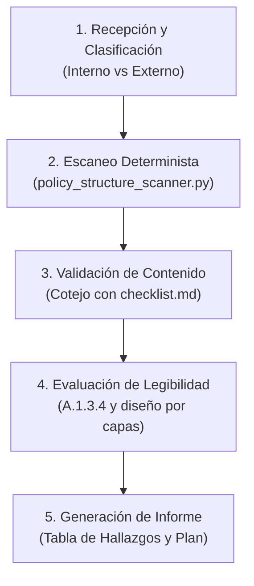

# Privacy Policy Reviewer (ISO/IEC 27701:2025)

## 1. Propósito y Alcance Normativo

La skill `privacy-policy-reviewer` audita y formula instrumentos normativos y documentales de privacidad dentro del marco del estándar internacional **ISO/IEC 27701:2025** (*Privacy Information Management System - PIMS*). 

La norma establece una distinción estructural obligatoria entre dos niveles documentales complementarios:
1. **La Política de Privacidad del SGIP / PIMS (Cláusula 5.2 y A.3.3)**: Directriz estratégica interna aprobada formalmente por la Alta Dirección para fijar el compromiso de cumplimiento, marco de objetivos y mejora continua.
2. **El Aviso / Notificación de Privacidad a los Titulares (A.1.3.3 y A.1.3.4)**: Instrumento informativo externo dirigido a las personas físicas (*PII principals*) para garantizar el principio de transparencia, lealtad y licitud.

---

## 2. Disparadores de Activación (User Triggers)

Esta skill debe activarse de forma prioritaria cuando el usuario solicite:
- *"Revisa el aviso de privacidad de nuestra página web para verificar cumplimiento con ISO 27701 y RGPD."*
- *"Audit our corporate privacy policy against Clause 5.2 and control A.1.3.3."*
- *"¿Qué elementos mandatorios le faltan a la política de privacidad de nuestra aplicación móvil?"*
- *"Queremos estructurar un aviso de privacidad por capas para un nuevo servicio digital."*
- *"Verifica si nuestra política interna de protección de datos cumple los requisitos de la alta dirección según ISO 27701:2025."*
- *"Evalúa si el lenguaje de nuestra política de privacidad es claro y accesible bajo el control A.1.3.4."*

---

## 3. Demarcación de Fronteras y Reglas de Qué NO Hacer

Para evitar duplicidades y mantener la integridad del ecosistema de auditoría:

### Qué NO Hacer
- **NO brindar asesoría jurídica vinculante ni dictámenes legales definitivos**: La skill actúa como herramienta de auditoría técnica y aseguramiento de conformidad con el SGIP.
- **NO asumir finalidades no declaradas, bases jurídicas implícitas o destinatarios no descritos**: Si la información no consta en el texto, se debe marcar la omisión como hallazgo y requerir los datos faltantes al usuario sin conjeturas.
- **NO auditar casillas de verificación (checkboxes), banners de cookies (CMP) ni trazabilidad técnica de logs de consentimiento**: Si el usuario consulta sobre la validez del opt-in o la UI de recolección, **derivar a `consent-validator`**.
- **NO tramitar peticiones de derechos de titulares (ARCO / DSAR)**: Si el usuario desea resolver una solicitud de acceso o supresión de un titular concreto, **derivar a `pii-rights-manager`**.
- **NO auditar Acuerdos de Encargo de Tratamiento (DPA) con proveedores B2B**: Si el documento bajo análisis es un contrato entre Responsable y Encargado, **derivar a `processor-contract-validator`**.
- **NO evaluar transferencias internacionales a nivel de salvaguardas contractuales (SCC/TIA)**: Solo se verifica si el aviso menciona su existencia; el análisis a fondo del flujo transfronterizo corresponde a **`pii-transfer-auditor`**.

---

## 4. Flujo de Trabajo Paso a Paso



### Paso 1: Recepción y Clasificación Documental
Identificar la tipología del artefacto proporcionado:
- **Tipo A: Política Interna del SGIP (Cláusula 5.2 / A.3.3)**: Documento de gobernanza interna, directrices corporativas, aprobaciones directivas y políticas de seguridad vinculadas a PII.
- **Tipo B: Aviso / Información para Titulares (A.1.3.3 / A.1.3.4)**: Aviso web, texto de app, formulario informativo de captación de datos.
- Si el usuario suministra un texto mixto o no especificado, consultar de inmediato el propósito o clasificar de manera desglosada por secciones.

### Paso 2: Escaneo Estructural Determinista
Ejecutar el script de análisis determinista sobre el texto o archivo Markdown para obtener la tasa objetiva de completitud y advertir omisiones preliminares:
```bash
python skills/privacy-policy-reviewer/scripts/policy_structure_scanner.py --file <ruta_archivo> --type <notice|internal_policy|auto> --format markdown
```
El script reporta métricas de cobertura porcentual, desglose por control y recuento de legibilidad.

### Paso 3: Validación de Contenido Mandatorio
Contrastar sistemáticamente el documento contra la lista exhaustiva en [checklist.md](references/checklist.md):
- **Para Políticas Internas (Cláusula 5.2 / A.3.3)**:
  1. Adecuación al propósito y contexto institucional.
  2. Marco para los objetivos de privacidad (enlace con Cláusula 6.2).
  3. Declaración expresa de cumplimiento legal y contractual.
  4. Compromiso de mejora continua del SGIP (Cláusula 10.2).
  5. Información documentada formal: fecha, versión, aprobación de Alta Dirección.
  6. Mecanismos de comunicación interna y comprensión (Cláusula 7.3).
  7. Disponibilidad para partes interesadas pertinentes.
  8. Políticas de seguridad temáticas con tratamiento de PII (A.3.3).
- **Para Avisos de Privacidad a Titulares (A.1.3.3)**:
  1. Identidad y razón social del responsable.
  2. Datos de contacto y canal del DPO / Encargado de Privacidad.
  3. Finalidades específicas (prohibidas finalidades genéricas).
  4. Base legal individualizada para cada finalidad (A.1.2.3).
  5. Categorías de datos personales recabados y origen (si es indirecto).
  6. Obligatoriedad de entrega y consecuencias de la negativa.
  7. Destinatarios y categorías de terceros.
  8. Transferencias internacionales y salvaguardas (A.1.5.2).
  9. Plazos objetivos o criterios de retención (A.1.4.8).
  10. Catálogo de derechos ARCO/DSAR y canal gratuito de atención.
  11. Procedimiento para revocar el consentimiento (A.1.3.5).
  12. Existencia de profiling o decisiones automatizadas y su lógica (A.1.3.11).
  13. Derecho a reclamar ante la Autoridad de Control competente.

### Paso 4: Evaluación de Legibilidad y Transparencia (A.1.3.4)
Auditar la forma de entrega y usabilidad:
- **Claridad lingüística**: Evaluar que no existan cláusulas oscuras, oraciones de más de 35 palabras o terminología jurídica innecesariamente compleja.
- **Arquitectura por capas (*Layered Notice*)**:
  - **Capa 1**: Resumen inmediato visible en el momento de recolección (tabla sinóptica con identidad, fines, legitimación y derechos).
  - **Capa 2**: Texto normativo íntegro y detallado con acceso permanente.
- **Oportunidad (*Timing*)**: Verificar si el aviso se presenta antes o al momento de recabar los datos.
- **Disponibilidad permanente**: Confirmar enlace visible e ininterrumpido en el entorno del usuario.

### Paso 5: Generación del Informe de Hallazgos y Plan de Subsanación
Consolidar el dictamen en la tabla estándar de hallazgos clasificados por severidad, detallando la evidencia faltante y la redacción correctiva exacta recomendada.

---

## 5. Matriz de Clasificación de Severidad de Hallazgos

| Severidad | Definición | Impacto en el SGIP | Plazo de Subsanación |
|---|---|---|---|
| **Crítica** | Omisión de requisitos esenciales que invalidan la transparencia o constituyen infracción sancionable inmediata. | Compromete la legalidad del tratamiento y la validez del SGIP. | Inmediato (< 5 días) |
| **Mayor** | Deficiencia sustancial que genera opacidad o incumple directrices mandatorias de control sin anular todo el documento. | Riesgo elevado de no conformidad en auditoría externa de certificación. | Corto plazo (< 15 días) |
| **Menor** | Imprecisión técnica, omisión formal o desactualización leve que no lesiona gravemente los derechos de los titulares. | Observación auditable a subsanar antes del siguiente ciclo. | Medio plazo (< 30 días) |
| **Oportunidad de Mejora** | Sugerencia de optimización de usabilidad, diseño visual o redacción que aporta valor al titular. | No constituye no conformidad pero eleva la madurez del PIMS. | En revisión ordinaria |

---

## 6. Formato Estándar de la Tabla de Hallazgos

Todo informe emitido por esta skill debe presentar los hallazgos en la siguiente estructura tabular unificada:

| ID | Control ISO/IEC 27701:2025 | Elemento Evaluado | Severidad | Hallazgo / Evidencia Faltante | Recomendación de Subsanación (Acción Concreta) |
|---|---|---|---|---|---|
| **H-01** | Cláusula 5.2 c) | Compromiso Legal | Crítica | El documento no declara el compromiso formal de cumplir con la legislación aplicable de privacidad. | Incluir cláusula formal de acatamiento a las leyes de protección de datos vigentes en las jurisdicciones de operación. |
| **H-02** | Control A.1.3.3 d) | Base Legal | Crítica | Se enumeran finalidades publicitarias sin asociarles la base jurídica de legitimación (consentimiento). | Asociar cada finalidad individual a su respectiva base jurídica, diferenciando la ejecución contractual del consentimiento voluntario. |
| **H-03** | Control A.1.3.3 j) | Plazos de Retención | Mayor | Se indica genéricamente que los datos se guardarán "el tiempo que sea necesario". | Establecer plazos específicos en años o criterios objetivos vinculados a los plazos legales de prescripción. |
| **H-04** | Control A.1.3.4 | Capas de Información | Oportunidad | El aviso consiste en un bloque único de texto sin resumen inicial. | Implementar un aviso en dos capas: tabla resumen básica en el punto de contacto y enlace al documento completo. |

---

## 7. Referencias y Recursos de Apoyo

Para consultar criterios ampliados, ejemplos de redacción y particularidades normativas:
- **Lista detallada de verificación**: [references/checklist.md](references/checklist.md)
- **Script de análisis determinista**: [scripts/policy_structure_scanner.py](scripts/policy_structure_scanner.py)
