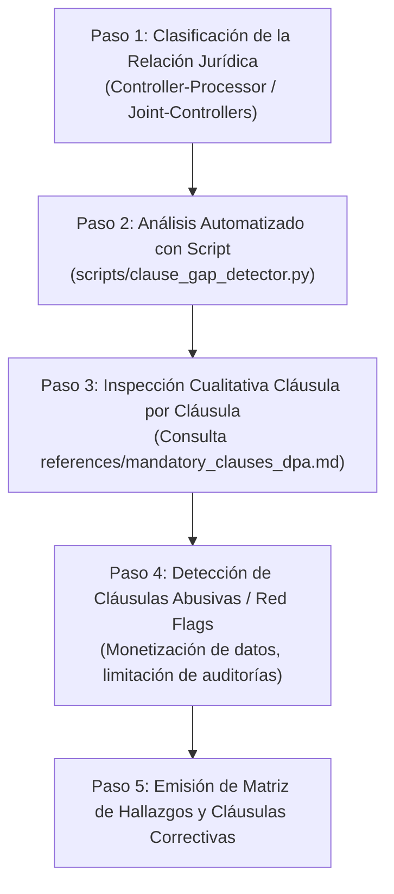

# Processor Contract Validator - Manual Operativo de Auditoría Contractual

## 1. Alcance y Fundamentación Normativa

Esta skill audita la relación jurídica, operativa y técnica entre responsables del tratamiento (*PII controllers*), corresponsables (*joint controllers*) y encargados del tratamiento (*PII processors* / subencargados), validando que los contratos marco, términos de servicio y Acuerdos de Tratamiento de Datos (*Data Processing Agreements* - DPA) cumplan con los requisitos normativos mandatorios de **ISO/IEC 27701:2025**, articulados con las regulaciones internacionales de privacidad (ej. RGPD Art. 26 y 28, LGPD Art. 39).

### 1.1 Controles Nucleares Auditados
- **Control A.1.2.7 (Guía B.1.2.7)**: *Contracts with PII processors* (Contrato formal por escrito, contenido mínimo indisponible y presunción de obligatoriedad de la Tabla A.2).
- **Control A.1.2.8 (Guía B.1.2.8)**: *Joint PII controller* (Reparto transparente de responsabilidades, protocolo de brechas y designación de punto de contacto único).
- **Categoría A.2.2 (Guías B.2.2.2 a B.2.2.7)**: *Conditions for collection and processing* (Sujeción a instrucciones documentadas, prohibición de finalidades propias, deber de advertencia ante instrucciones infractoras, demostración de cumplimiento y ROPA de encargado).
- **Controles A.2.5.7, A.2.5.8 y A.2.5.9 (Guías B.2.5.7 a B.2.5.9)**: *Subcontractor management* (Transparencia previa, autorización escrita previa, cláusulas espejo *flow-down*, notificación previa de sustituciones y derecho de oposición/resolución).
- **Control A.3.10 (Guía B.3.10)**: *Addressing information security within supplier agreements* (Salvaguardas de seguridad técnicas y organizativas derivadas de ISO/IEC 27002:2022).

### 1.2 Regla Presuntiva de Relevancia de la Tabla A.2
Bajo ISO/IEC 27701:2025, el responsable debe exigir al encargado el cumplimiento de **todos los controles de la Tabla A.2**.
> **Regla de Auditoría**: Todo control de la Tabla A.2 se presume normativamente relevante y obligatorio para el encargado del tratamiento. Si una organización pretende excluir cualquier control de la Tabla A.2 de su contrato con un proveedor, debe acreditar una justificación técnica formal documentada en su Declaración de Aplicabilidad (SoA, Cláusula 6.1.3). La simple omisión involuntaria o la ausencia de mención en el contrato se clasifica como una **No Conformidad Mayor**.

---

## 2. Decálogo de Controles Contractuales Obligatorios

Todo DPA o contrato de encargo debe contener taxativamente las siguientes 10 estipulaciones obligatorias:

1. **Objeto, Duración, Naturaleza y Finalidad (A.1.2.7, A.2.2.3)**: Descripción detallada de las operaciones autorizadas, tipos de PII tratadas y categorías de titulares afectados.
2. **Sujeción Estricta a Instrucciones Documentadas (A.2.2.3)**: Prohibición absoluta de tratar la PII para finalidades propias, analítica comercial, monetización o entrenamiento de modelos de inteligencia artificial no autorizados.
3. **Deber de Confidencialidad (A.1.2.7, A.3.10)**: Compromiso legal vinculante de confidencialidad del personal autorizado o sujeción a obligación legal estatutaria de secreto.
4. **Medidas Técnicas y Organizativas de Seguridad (A.1.2.7, A.3.10)**: Especificación o anexo técnico que detalle medidas de cifrado en reposo/tránsito, control de acceso basado en roles, copias de seguridad y resiliencia.
5. **Régimen de Subcontratación y Derecho de Oposición (A.2.5.7, A.2.5.8, A.2.5.9)**: Prohibición de subencargar sin autorización previa (específica o general por escrito), imposición de cláusulas espejo (*flow-down* contractual) y concesión de un plazo razonable (mínimo 10-30 días) para que el cliente pueda oponerse o resolver el contrato ante nuevos subencargados.
6. **Asistencia en el Ejercicio de Derechos de Titulares (A.1.2.7, A.2.3.2)**: Obligación técnica del encargado de colaborar y proveer herramientas para responder solicitudes ARCO/DSAR sin dilación.
7. **Asistencia en Evaluaciones de Impacto y Consulta Previa (A.1.2.7, A.2.2.2)**: Suministro de información técnica y de arquitectura para la elaboración de Evaluaciones de Impacto en la Privacidad (PIA).
8. **Notificación Inmediata de Brechas de Seguridad (A.1.2.7, B.2.2.2, B.3.12)**: Obligación de notificar al responsable de forma inmediata (plazo máximo habitual de 24 a 48 horas tras tener conocimiento) ante cualquier brecha confirmada o sospecha fundada que comprometa PII.
9. **Destino Final de la PII al Término del Servicio (A.1.2.7, A.2.4.3)**: Obligación expresa de devolver o suprimir íntegramente la PII de todos los entornos productivos y de respaldo, aportando certificado formal de destrucción segura.
10. **Derecho de Auditoría, Inspección y Demostración de Cumplimiento (A.1.2.7, A.2.2.6)**: Facilitar toda la información probatoria necesaria y permitir inspecciones físicas o lógicas por parte del responsable o de un auditor independiente designado.

*En relaciones de Corresponsabilidad (A.1.2.8)*, se suma el requisito mandatorio de definir con precisión el reparto de roles, el protocolo mancomunado de atención a incidentes y la designación de un **punto de contacto único** para el titular.

---

## 3. Flujo de Trabajo Operativo de Auditoría



### Paso 1: Clasificación de la Relación Jurídica y Alcance
- Determinar si el documento corresponde a un contrato de encargo (*Controller-to-Processor*), subencargo (*Processor-to-Subprocessor*) o acuerdo de corresponsabilidad (*Joint Controllers*, A.1.2.8).
- Identificar los flujos de datos: tipología de PII, categorías de titulares y criticidad operativa.

### Paso 2: Ejecución del Analizador Determinista de Brechas
- Ejecutar el script determinista de soporte sobre el texto contractual:
  ```bash
  python skills/processor-contract-validator/scripts/clause_gap_detector.py --file ruta/al/contrato_o_dpa.txt --report
  ```
- El script examina de forma reproducible las 10 cláusulas obligatorias, evalúa señales de advertencia (*red flags*) y calcula el porcentaje de cobertura normativa preliminar.

### Paso 3: Inspección Cualitativa y Validación de Controles de la Tabla A.2
- Contrastar cada sección del contrato contra el catálogo exhaustivo en [mandatory_clauses_dpa.md](references/mandatory_clauses_dpa.md).
- Verificar que las cláusulas no sean meras fórmulas retóricas o vacías (ej. *"el proveedor aplicará la seguridad que considere conveniente"* es no conforme con A.3.10).

### Paso 4: Detección de Cláusulas Abusivas o Trampas Contractuales Frecuentes
- Identificar disposiciones lesivas comúnmente insertadas en contratos de adhesión de proveedores tecnológicos:
  - **Auto-atribución de uso secundario**: Permiso para entrenar modelos fundacionales, analítica interna o enriquecimiento de bases de datos propias con PII del cliente.
  - **Fricción desmedida o bloqueo de auditorías**: Cobro de tarifas abusivas por permitir auditorías o imposición de limitaciones que restringen la verificación a un simple resumen ejecutivo no auditable.
  - **Falta de preaviso en subcontratación**: Notificación pasiva (ej. *"consulte periódicamente nuestra web"*) en lugar de notificación activa con derecho explícito de rescisión sin penalización.
  - **Cláusulas leoninas de retención**: Negativa a entregar o borrar datos hasta el pago de controversias no vinculadas a la protección de datos.

### Paso 5: Generación del Dictamen y Cláusulas Correctivas
- Estructurar el informe de auditoría utilizando la matriz de hallazgos estándar.
- Por cada deficiencia encontrada, redactar la cláusula contractual sustitutiva exacta, jurídicamente equilibrada y lista para ser incorporada al pliego de negociación.

---

## 4. Matriz de Severidad y Formato de Hallazgos

### 4.1 Criterios de Severidad
- **Crítica**: Ausencia total de DPA firmado; el proveedor se reserva el derecho a usar PII para fines propios; exclusión total del derecho de auditoría; o ausencia de cláusula de confidencialidad y medidas de seguridad.
- **Mayor**: Ausencia de derecho formal de oposición a nuevos subencargados; plazo indefinido o superior a 72 horas para notificar brechas; ausencia de compromiso de devolución/destrucción formal de PII al término del servicio.
- **Menor**: Cláusula de asistencia en derechos o PIA redactada de forma ambigua sin plazos operativos concretos; falta de mención al deber de alertar sobre instrucciones ilegales (A.2.2.5).
- **Oportunidad de Mejora (OM)**: Ausencia de especificación del estándar técnico de destrucción (ej. ISO 27001 / NIST SP 800-88); conveniencia de anexar un catálogo preaprobado de subencargados.

### 4.2 Formato Estándar de la Tabla de Hallazgos

| Control ISO 27701:2025 | Severidad | Cláusula Contractual Evaluada (Evidencia) | Riesgo / Incumplimiento Normativo | Redacción Sugerida de Cláusula Correctiva |
|---|---|---|---|---|
| **A.1.2.7 / A.2.2.3** | Crítica | *"El Proveedor podrá tratar metadatos y contenido anonimizado o derivado para mejorar sus servicios algorítmicos propios."* | Vulneración de la prohibición de uso de PII para finalidades propias del encargado sin instrucción ni base legítima. | *"El Encargado tratará los datos personales única y exclusivamente conforme a las instrucciones documentadas del Responsable, absteniéndose expresamente de utilizarlos para finalidades propias, analíticas independientes o entrenamiento de tecnologías de IA."* |
| **A.2.5.9** | Mayor | *"El Proveedor actualizará la lista de subcontratistas en su sitio web de tiempo en tiempo sin previo aviso."* | Imposibilidad material de ejercer el derecho de oposición previa a nuevos subencargados (*vendor lock-in* forzado). | *"El Encargado notificará por escrito al Responsable cualquier incorporación o sustitución de un subencargado con al menos 30 días de antelación, pudiendo el Responsable oponerse formalmente o rescindir el contrato sin penalización."* |
| **A.1.2.7 / A.2.4.3** | Mayor | *Cláusula omitida en el contrato respecto a la devolución de datos.* | Riesgo de retención indefinida y fuga de PII tras la extinción de la relación mercantil. | *"A la finalización del servicio, el Encargado devolverá o destruirá a elección del Responsable todos los datos personales en su posesión, emitiendo un certificado formal de borrado seguro según estándares de la industria."* |

---

## 5. Qué NO Debe Hacer Esta Skill

Para salvaguardar la exactitud técnica y evitar solapamientos funcionales en el ecosistema, esta skill **BAJO NINGUNA CIRCUNSTANCIA DEBE**:

1. **NO emitir asesoría jurídica definitiva o vinculante**: El análisis es una auditoría técnica y normativa de cumplimiento de ISO/IEC 27701:2025 y regulaciones aplicables. Todo hallazgo debe presentarse como recomendación de auditoría orientada al oficial de privacidad, auditor o asesor legal corporativo.
2. **NO asumir estipulaciones no documentadas**: Si el contrato calla sobre el plazo de notificación de brechas de datos o el procedimiento de auditoría, NO asumir que *"se entiende implícito según la ley"*. Debe registrarse taxativamente como **Cláusula Omitida / No Conformidad**.
3. **NO auditar anexos de transferencias transfronterizas ni Evaluaciones de Impacto de Transferencia (TIA)**: Si el contrato involucra centros de datos en el extranjero, Cláusulas Contractuales Tipo (SCC) o legislación foránea, limitar la evaluación a las cláusulas B2B generales y **derivar formalmente a `pii-transfer-auditor`**.
4. **NO validar los mecanismos de recolección de consentimiento ni avisos dirigidos al usuario final**: Los formularios web y políticas públicas de cara al titular corresponden a `consent-validator` y `privacy-policy-reviewer`.
5. **NO gestionar brechas de seguridad en tiempo real ni ejecutar investigaciones forenses**: Si un proveedor reporta una brecha activa, la gestión de crisis y plazos legales ante la autoridad corresponde a `incident-response-planner`.
6. **NO aceptar cláusulas de cumplimiento genérico como sustituto de los controles de la Tabla A.2**: Frases vacías del estilo *"las partes cumplirán con la legislación de datos aplicable"* NO subsanan la ausencia de las 10 estipulaciones mandatorias.

---

## 6. Documentación de Referencia y Herramientas

- **Catálogo de Cláusulas Obligatorias**: Consultar [mandatory_clauses_dpa.md](references/mandatory_clauses_dpa.md) para ejemplos comparativos de cláusulas deficientes frente a cláusulas conformes.
- **Herramienta Determinista de Soporte**: Utilizar `skills/processor-contract-validator/scripts/clause_gap_detector.py` para la comprobación preliminar automatizada de omisiones en contratos y DPAs.
